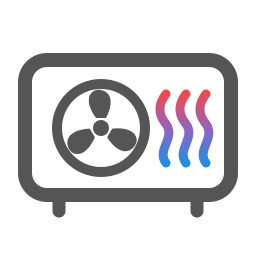

<p align="center">
  
</p>

<h1 align="center">Bosch/Buderus Home Comfort</h1>

<p align="center">
  Connect compatible Bosch and Buderus heating, cooling, hot-water, air-treatment and water-softening devices to Home Assistant, with read-only wallbox monitoring.
</p>

<p align="center">
  <a href="https://github.com/SoftwareSchmied/ha-bosch-buderus-heating/actions/workflows/ci.yml"></a>
  <a href="https://github.com/SoftwareSchmied/ha-bosch-buderus-heating/actions/workflows/codeql.yml"></a>
  <a href="https://github.com/hacs/default/pull/10040"></a>
  <a href="LICENSE"></a>
</p>

> [!NOTE]
> The illustrated [setup guide](docs/setup.md) explains installation and
> sign-in step by step.

> [!IMPORTANT]
> **0.9.1 is the current stable version.** It fixes the cloud sign-in of
> 0.9.0, improves the local access and names the heat generator models. It
> needs Home Assistant 2026.5.0 or newer. From 0.8.x the configuration entry
> moves to storage format 4, which 0.8.x cannot load. Make a full Home
> Assistant backup before you update; going back to 0.8.x is only possible
> by restoring it. See the
> [release notes](https://github.com/SoftwareSchmied/ha-bosch-buderus-heating/releases/tag/v0.9.1).

## What's new in 0.9

- **Local access:** reads K40/K40RF gateways (for example the MX300 or MX400 internet module) directly in your home network. It only reads; changes still go through the cloud. Confirmed on my own heat pump and on two further Logatherm WLW186i heat pumps with an MX400.
- **More and fresher readings:** many values update more often, and some are only available locally (for example refrigerant circuit, compressor and pump values).
- **Works without the cloud:** with a local access, your readings stay available when the cloud is not.
- **Cloud and local access in one entry:** **Configure → Connections** shows, tests, signs in again, switches off or removes each access.
- **Fewer cloud requests:** while an entity shows the value of the local access, its cloud copy is read at most every 15 minutes, as a whole multiple of its normal interval and only for readings polled every 7.5 minutes or more often; counters, values that can be changed and values that a control or a calculated entity reads keep their normal interval.
- **Less load on Home Assistant, without losing any functionality:** entities write a new state only when their value, availability or source changes. My measurements are in the [release checks](docs/release.md#load-measurement-for-090-alpha2).
- **More robust:** cloud outages at start-up, missing parts, firmware updates, rate-limit pauses and an exchanged gateway no longer need a restart, and readings stay shown within their validity during short outages.
- **Room controllers:** room controllers of the RRC 2.0 platform (TC100.2, CT200) get their zone climates, programs, absences, hot water, heating circuit and radio devices. On a TC100.2 the zone climates, program selection, temporary setpoint, open window detection, a one-day absence, hot water mode, boost, away mode and advancing the next switch point are confirmed; the other room controller functions and the CT200 are expected to work but untested on a real controller.
- **Schedules, iCom and firmware:** the weekly heating and hot water schedules of EMS and iCom gateways can be changed in the Configure dialog, iCom gateways get a cloud-friendly load profile, and each cloud gateway shows its firmware and offered updates. A heating circuit without a room controller that offers a temporary setpoint takes a target in automatic mode as well. Changing the hot water schedule was confirmed on a Logatherm WLW186i-12 E with an MX400; the other functions are tested with simulated data only and are expected to work but untested on a real device.
- **Faults and languages:** fault and maintenance notifications are clearer, and the texts come in 19 languages.

**Tested on:** my own heat pump (Logamatic BC400 controller, MX400 internet module reported as K40RF gateway, firmware 15.00.01), where it runs without problems, and the [confirmed installations](#confirmed-installations).

**Feedback:** please share your experience in the [0.9 feedback discussion](https://github.com/SoftwareSchmied/ha-bosch-buderus-heating/discussions/111) and report bugs as [issues](https://github.com/SoftwareSchmied/ha-bosch-buderus-heating/issues/new?template=bug.yml).

Bosch/Buderus Home Comfort (formerly Bosch/Buderus Heating) is an unofficial Home Assistant custom integration.
It discovers PointT heating-system resources and uses separate cloud adapters
for identified additional appliances. Entities follow each system's reported
capabilities; the [compatibility section](#compatibility) documents the supported
families and the limits of their validation.

<a id="unreleased-development-work"></a>

<a id="new-pointt-controls-in-beta7"></a>

## PointT controls

The integration offers a tabbed **Operate appliance** dialog, clearer
device-page controls, PointT heating-circuit climates and a native PointT
hot-water entity.

The dialog opens under **Settings > Devices & services > Bosch/Buderus Home Comfort >
Configure > Operate appliance**. It keeps edits as a draft until **Apply**.
The device page offers the native climate and hot-water controls; its individual
controls continue to write immediately. Existing IDs and customizations remain.
See [Heating controls](docs/heating-controls.md),
[PointT hot water](docs/pointt-hot-water.md) and
[Connection recovery](docs/connection-recovery.md).

On my Buderus installation, I confirmed a manual heating target change and
restoration through the dialog and climate entity, plus Auto to Off and back
to Auto through the hot-water entity. I checked both directions in MyBuderus
and restored all changed settings. This confirms those paths on my appliance;
other devices and failure scenarios still need their own field checks.
The [project status](docs/specification-status.md) records the release checks
and remaining field validation.

## Built for real heating systems

Heating installations rarely have identical layouts. This integration treats
the PointT resource tree as the source of truth: it discovers the connected
system, creates only entities that are actually supported, and keeps the
original API path behind every value documented. One heating circuit works;
additional circuits, heat generators, hot-water circuits, and gateways follow
the same dynamic model without requiring model-specific entity lists.

Reliability is designed into the complete data path:

- **Capability based:** entities and controls follow the resources and metadata
  reported by the installation, not assumptions based only on a product name.
- **Transparent:** the entity catalog maps human-readable names to their exact
  PointT paths and raw fields, including every calculated energy value.
- **Conservative when writing:** limits and allowed values are validated again
  immediately before a change; the request is never retried blindly and must
  be confirmed by a separate read-back.
- **Efficient in the cloud:** resources with similar update needs are fetched
  together, while live values, settings, energy counters, and static data use
  different polling intervals.
- **Resilient:** partial responses are preserved, temporary failures retain the
  last confirmed state, unknown enum values do not break an update, and rate
  limits trigger bounded backoff.
- **Supportable without exposing the home:** diagnostics show capability and
  request results while excluding credentials, raw measurements, stable device
  identifiers, and user-defined names.
- **Understandable:** German and English terminology is based on the heating
  apps and technical documentation, with dynamic names such as
  `Heating circuit 1 – Operation mode` that remain clear on larger
  installations. The [language guide](docs/resource-names-and-languages.md)
  explains system-language names, profile-language dialogs and custom names.

The result is an integration that aims to remain predictable not only during
initial setup, but also when the cloud is slow, a resource is unavailable, or
the installation exposes a combination of capabilities that has not been seen
before.

## Cloud access and local access

The integration can use the cloud access (sign-in of the manufacturer's app),
the local access to a K40/K40RF gateway in your home network, or both:

- the **cloud access** shows the readings and lets you operate the system;
- the **local access** only reads, but updates many readings more often and
  can add technical readings the cloud does not offer;
- with **both**, each reading is shown once; with the cloud running, it comes
  from the local access while it is current and **Use local values for
  existing entities** is on (the default when a system gets its first local
  access), otherwise from the cloud; changes always go through the cloud.

Without the cloud (switched off, a new sign-in needed, paused, rate-limited or
unreachable), a system with a local access always shows its readings from the
local access, independent of that option, read-only. When the cloud comes
back, it takes over the same entities with their history. See [operation without the cloud](docs/operation-without-cloud.md).

## Features

- Automatic discovery of supported PointT resources
- Support for multiple gateways and dynamically discovered circuits
- Optional read-only local access to K40/K40RF gateways,
  also without the cloud; faults and bell notifications then follow the
  gateway's local error list
- Temperatures, system pressure, operating states, instantaneous heat-source
  power, brine temperatures, starts, and operating hours
- Capability-gated read-only monitoring for optional hybrid, low-noise,
  power-limit, solar, pool, ventilation, room-zone, room-device, photovoltaic,
  fresh-water-station, and variable-tariff resources
- Active system faults, warnings, and maintenance notifications with lifecycle
  events for Home Assistant automations
- Home Assistant bell notifications for active faults, enabled by default and
  configurable per installation under **Configure > Notifications**. Dismissed
  incidents stay hidden across polls and restarts; no extra cloud requests are
  needed. See [fault notifications](docs/faults.md) for the full behavior.
- Optional holiday status and calendar with support for multiple periods,
  gateway-aware time zones, and capability-gated create, edit, and delete
  actions, kept separate from Away mode
- Cumulative electricity, produced heat, cooling energy, and calculated
  environmental energy
- A clearly identified calculated dew point when a heating circuit reports
  both room temperature and relative humidity
- Heating-circuit and hot-water controls exposed only when PointT reports them
  as writable
- Silent Mode control with Off, Automatic, and On when the gateway advertises
  the exact writable capability
- Auxiliary-heater mode control with Off, On, and Auto, plus a guarded
  maximum-supply-temperature control for supported heating circuits
- Mandatory read-back after every write; writes are never retried blindly
- Separate polling intervals for live, configuration, energy, long-term, and
  static values
- Last confirmed values remain available during temporary cloud failures
- Reauthentication, gateway selection, resource rediscovery, and selectable
  polling profiles
- Privacy-preserving Home Assistant diagnostics with capability counters,
  rolling 60-minute request and latency metrics, and a bounded sanitized log
  of individual HTTP attempts
- German and English entity names and state translations, plus Czech and
  Slovak reviewed (their texts added since 0.9.0-alpha.5 are still drafts),
  and Swedish, Norwegian Bokmål, Finnish, Danish,
  French, Spanish, Italian, Portuguese, Dutch, Polish, Greek, Bulgarian,
  Croatian, Slovenian and Irish as drafts awaiting review by native
  speakers; the
  [translation guide](docs/translations.md) lists the languages with their
  glossaries and explains how to correct or add one

Normal measurements and everyday controls are enabled on a fresh installation.
The installer-level maximum-supply-temperature control, identity data, detailed
system information, raw software-update fields, and read-only copies of an
existing control remain available only as opt-in diagnostics.
Cloud resources the integration does not know yet appear as disabled
diagnostic sensors, never as controls. Identifiers, network data and other
privacy-sensitive values never become entities.

## Compatibility

The integration uses the cloud interface shared by the Bosch and Buderus
heating apps. Compatibility depends on the resources exposed for the specific
account, gateway, controller, and heating system.

The integration requires **Home Assistant 2026.5.0 or newer**. HACS does not
offer it to older installations. The automated checks run the full test suite
on Home Assistant 2026.5.4, 2026.9.2 and the current release.

| Status | Systems |
|---|---|
| In use | Many installations with heat pumps and gas condensing boilers |
| Brands | Cloud access: systems registered in the Bosch or Buderus app; IVT, Junkers, Nefit, Worcester and Vulcano systems should work, not confirmed. Local access: K40/K40RF gateways of Bosch, Buderus, IVT, Vulcano and Worcester, confirmed with Buderus |
| Tested on my system | Buderus heat pump with a Logamatic BC400 controller and an MX400 internet module (K40/K40RF gateway), cloud and local access |
| Designed for | Systems with an MX300 or MX400 internet module or a K30 RF/K40 RF Connect-Key, reported by PointT as K30/K30RF or K40/K40RF gateways |
| Optional when reported | Solar, pool, ventilation, room zones, room devices, PV status, hybrid and tariff resources |
| Room controllers (RRC 2.0) | TC100.2: zone readings, manual/schedule mode and manual setpoint confirmed with 0.9.0-alpha.4; program selection, temporary setpoint with its clear button, open window detection of a zone, a one-day absence, hot water mode, boost and away mode confirmed with 0.9.0-alpha.5; advancing the next switch point confirmed with 0.9.0-alpha.6; the system and radio device readings look right. Editing switch points, other absence changes, the other hot water settings, heating circuit, fault and maintenance sensors, energy history and radio device settings: expected, untested. CT200: expected, untested. Cloud only, no local access. See [room controllers](docs/room-controllers.md) |
| Additional device families | Midea/RWH water heaters, Midea Climate Series, seven air purifier families, Dry 4000i/6000i/8000i and read-only wallboxes |
| Optional local access | K40/K40RF gateways with firmware 15.00.01 or newer, read-only over the local network next to the cloud access; only the heating system, not air conditioners, wallboxes or other devices of the account. See [compatibility](docs/compatibility.md) |
| Not covered | Matter devices, arbitrary MQTT devices and gateway network administration |

The additional device families use their own adapters and supported
Home Assistant entity types. Available functions depend on identification,
reported metadata and explicit device selection. See the
[device families](docs/device-support-plan.md) and the [current scope](docs/specification-status.md) for details.

An unlisted model may still work because discovery is capability based. A
listed gateway does not by itself guarantee that every entity or control is
available. Missing capabilities are simply omitted without affecting the rest
of the integration.

Systems registered in the IVT Anywhere II app, and Junkers, Nefit, Worcester
or Vulcano systems registered in the Bosch HomeCom Easy app, use the same
cloud. They should work when you select **Bosch** during setup and sign in
with the SingleKey ID of that app. The local access also recognises K40/K40RF
gateways of IVT, Vulcano and Worcester. No IVT, Junkers, Nefit, Worcester or
Vulcano system has been confirmed yet, neither with the cloud nor with the
local access; if you use one, please share your experience in
[Share your installation](https://github.com/SoftwareSchmied/ha-bosch-buderus-heating/discussions/81).

Home Assistant shows a uniquely identified MX300/MX400 internet module as the
system model. K30/K40 is the gateway type that PointT reports for these modules
and remains visible in diagnostics and the gateway hardware data.

> [!IMPORTANT]
> The PointT Cloud API is not a publicly guaranteed API. Cloud-side changes may
> affect the integration. Keep the original Bosch or Buderus app available for
> commissioning and service work.

### Confirmed installations

Users' reports and my own reference installation confirm the integration on
these heaters. A feature that is not listed was not reported, which does not
mean it does not work. The same list is also available as
[Confirmed installations](docs/confirmed-installations.md).

| Manufacturer | Model | Variants | Type | Controller | Gateway / internet module | Confirmed features |
|---|---|---|---|---|---|---|
| Buderus | Logatherm WLW176i | WLW176i-12 TP70, WLW-10 MB AR | air-to-water heat pump (monobloc) | Logamatic BC400 | MX400, K40RF | readings, heating setpoint, hot water mode, holidays, time programs (read-only), faults and notifications, energy counters, local access, operation without cloud |
| Buderus | Logatherm WLW186i | WLW186i-12 TP70, WLW186i-12 TP70 W, WLW186i-12 E | air-to-water heat pump (monobloc) | Logamatic BC400 | MX400, K40RF | readings, heating controls, time programs (read-only), hot water schedule changes (WLW186i-12 E), local access |
| Buderus | Logatherm WLW196i | WLW196i AR | air-to-water heat pump (split) | – | MX300, K30 | readings, holidays (read-only) |
| Buderus | Logamax plus GB172 | – | gas condensing boiler, wall-hung | Logamatic RC310 | Logamatic web KM200 | readings |
| Buderus | Logamax plus GBH192i.2 | GBH192i.2-25 H | gas condensing boiler, wall-hung | – | MX300 | readings, energy counters, hot water, faults, holidays (read-only) |
| Buderus | Logano plus GB212 | GB212-22 H | gas condensing boiler, floor-standing | Logamatic TC100.2 | built-in Wi-Fi | readings, faults and notifications, room controller zones (setpoints, modes, schedules, open window detection, absences), hot water mode, boost, away mode, radiator thermostats |
| Buderus | Logano G125 BE | G125 BE ECO-21 | oil boiler with burner | – | – | start counter (with the reporter's own fix) |

The Logatherm WLW176i is my own reference installation. "–" means not stated
in the report.

Is your system missing, or have you checked further features? Please post your
heater, controller, gateway and the features you checked in
[Share your installation](https://github.com/SoftwareSchmied/ha-bosch-buderus-heating/discussions/81), or in the
[0.9 feedback discussion](https://github.com/SoftwareSchmied/ha-bosch-buderus-heating/discussions/111) if you use a 0.9 version.
I will add it to the list.

## Installation

### 1. Install HACS if necessary

Follow the official [HACS installation guide](https://www.hacs.xyz/docs/use/download/download/),
restart Home Assistant, and complete the HACS setup under
**Settings → Devices & services**.

<a id="2-install-boschbuderus-heating"></a>

### 2. Install Bosch/Buderus Home Comfort

The integration is available directly in the default HACS catalog.

1. Open **HACS** in Home Assistant.
2. Search for **Bosch/Buderus Home Comfort**.
3. Open the matching repository and select **Download**.
4. Restart Home Assistant when prompted.

If the search does not show the integration, follow the
[search troubleshooting steps](docs/setup.md#repository-does-not-appear-in-hacs-search)
in the illustrated setup guide.

### 3. Add the integration

1. Open **Settings → Devices & services**.
2. Select **Add integration**.
3. Search for **Bosch/Buderus**, using the name shown by the installed version.
4. Select the brand of the app already connected to the heating system.
5. Sign in with the same SingleKey ID used by that app.
6. Select the gateway or gateways Home Assistant should use.

SingleKey ID returns the authorization result to a Bosch/Buderus app address
rather than a normal web page. A desktop browser cannot open that address
directly. The setup flow and the
[illustrated setup guide](docs/setup.md#sign-in-with-singlekey-id)
explain how to copy the complete return address safely from Chrome. Home
Assistant never asks for the SingleKey ID password.

> [!CAUTION]
> The return address contains a short-lived one-time authorization code. Never
> post it in an issue, chat, screenshot, or log.

## Entities

Entities are created from the capabilities reported by PointT. Their names
begin with the logical part of the heating system, which keeps related values
together even when several circuits exist. Examples include:

- `Heating circuit 1 – Operation mode`
- `Heating circuit 2 – Desired temperature`
- `Hot water – Actual temperature`
- `Heat pump – System pressure`
- `Total – Electricity consumption`

The [entity and polling catalog](docs/entities.md) documents every entity in
the reference installation, its PointT resource, write status, default state,
and polling interval.

### System faults and notifications

When the installation exposes PointT notifications, the integration creates:

- **System fault**, a problem binary sensor for faults, critical faults, and
  conservatively classified unknown notifications;
- **Active faults**, the number of currently active system problems;
- **Active notifications**, the number of all current notifications, including
  warnings and maintenance;
- **System notifications**, an event entity that emits `appeared` and
  `resolved` transitions.

Fault details are kept as bounded attributes instead of creating a separate
entity for every possible code. Known, independently worded summaries are
shown when their meaning has been verified. Unknown codes remain visible and
are never guessed. The integration observes when a fault first appears or
disappears in PointT; these Home Assistant observation times are not presented
as exact appliance timestamps.

**Where do I find faults?** Current faults, with code, subcode and
description, are in the `faults` attribute of **Active faults**. Past faults
are in the history and logbook of **System notifications** (`appeared` and
`resolved` events), as far back as the Home Assistant recorder keeps data.
The bell notification is not an archive. See
[where do I find faults](docs/faults.md#where-do-i-find-faults) for details
and an automation that keeps a permanent record.

The appliance display and the official
[Bosch error-code search](https://www.bosch-homecomfort.com/de/de/wohngebaeude/service-und-support/bosch-fehlercode-suche/)
remain the authoritative sources for detailed service information. Home
Assistant does not replace a qualified technician or manufacturer diagnosis.

### Holiday periods

When the gateway exposes PointT holiday resources, the integration creates a
**Holiday mode active** binary sensor and a **Holiday periods** calendar.
The **Next holiday** timestamp sensor makes the upcoming start visible on the
device page. Multiple configured periods are shown individually. Date-only values,
timestamps, gateway time zones, empty lists, and incomplete entries are handled
without affecting the rest of the integration.

Holiday mode is not the same as the existing **Away mode** switch. Holiday
periods may contain separate behavior for heating, hot water, and ventilation;
Away mode is a different PointT setting.

If the gateway advertises a current and complete holiday schema, the standard
Home Assistant calendar dialog also allows you to create, move, rename, and
delete periods. Open **Calendar**, select **Holiday periods**, and add or edit
an event. Use only a title plus start and end; recurrence, location, and
description are not supported by PointT.

When an existing period is edited, its heating, hot-water, ventilation,
thermal-disinfection, constant-temperature, and circuit-assignment settings are
preserved. A newly created period uses conservative defaults: all advertised
circuits, 17 °C constant-temperature heating when
supported, hot water off, ventilation off when supported, and thermal
disinfection on when supported. These defaults are checked against the actual
configuration. If a default is not offered, use **Configure → Manage holiday
periods → New holiday** to
choose dates and the modes provided by your installation before creating it.

To manage a holiday, open the integration's **Configure → Manage holiday
periods** dialog. Selecting a saved holiday opens its details directly.
Change its prefilled name, start and end,
assigned circuits, heating mode, hot-water mode, ventilation mode,
thermal-disinfection setting, and constant temperature. Only settings
supported by the connected system are shown.

When creating a holiday here, start and end times default to **08:00** and
remain editable. Both dates must be selected explicitly. Existing holidays
retain their saved times when opened for editing. Creating and editing use
the same form with supported settings together. Each date has its clock
directly beside it. The clock fields omit seconds. An end before or equal to the start produces
a clear message at the end field, while the entered values remain available.

The form saves directly. For an existing holiday, the red **Delete holiday
period completely** button at the bottom opens confirmation without saving
the draft. Check the saved name and dates before confirming. Declining
returns to editing with your unsaved inputs preserved. This also works when
the unsaved dates are incomplete or invalid.
The calendar remains an additional way to create, move, rename, or delete
periods. Every change is read back from PointT before Home Assistant accepts
it as successful. Notification settings remain accessible from the
integration's configuration dialog.

Midnight remains 00:00 on the selected date, without conversion to 24:00 or
rounding. If the system returns different settings, the actual holiday appears
immediately and the dialog shows the requested and returned periods. An
unresolved creation is checked again without sending another creation request
during the same loaded session.

The step-by-step [holiday-period guide](docs/holiday-periods.md) shows how to
create, configure, move, rename, and delete a period and explains every
available heating-system setting.

### Energy counters

All energy entities are cumulative counters in kWh. They do not represent
instantaneous power in kW.

| Entity | PointT source |
|---|---|
| `Total – Electricity consumption` | `totalConsumption → electricity`, otherwise `compressor + eheater` |
| `Total – Heat-pump electricity consumption` | `totalConsumption → compressor` |
| `Total – Electric auxiliary-heater consumption` | `totalConsumption → eheater` |
| `Total – Heat produced` | `totalConsumption → outputProduced` |
| `Total – Environmental energy (calculated)` | `outputProduced - compressor - eheater` |
| `Heating – …` | corresponding values from `chConsumption` |
| `Hot water – …` | corresponding values from `dhwConsumption` |
| `Cooling – …` | corresponding values from `coolingConsumption` |

The calculated environmental-energy entity is only created when all required
counters are present and valid. An incomplete or negative balance is not
reported as a measurement.

## Controls and safety

The integration can expose supported operating modes, temperature setpoints,
extra hot water, and away mode. Availability is determined for each
installation from the current PointT metadata.

Before a change is sent, the integration verifies that the resource is still
writable and that the requested value is within the advertised limits. Every
successful request is followed by a bounded read-back. If PointT does not
confirm the result, Home Assistant reports the change as unsuccessful instead
of assuming it worked.

Each resource provides its own options and numeric bounds. A circuit offering
only `manual` and `auto` remains writable, and additional advertised enum codes
are offered even when they have no translation yet. Options and limits update
during polling. Newly eligible discovered resources gain controls without a
restart; previously undiscovered paths still require rediscovery.

Numeric increments are UI hints. The observed PointT metadata does not establish
a write step, so a valid target inside the advertised bounds is not rejected
because it differs from an increment used on a reference installation. Legacy
switch IDs remain stable; variants with additional or fewer options also receive
a separate selection control.

## Polling and cloud load

The coordinator groups resources by how quickly they need to change:

| Data | Default interval |
|---|---:|
| Live operating values | 60 seconds |
| Notifications without an active notification | 5 minutes |
| Notifications while at least one is active | 60 seconds |
| Settings and energy counters | 5 minutes |
| Starts and operating hours | 15 minutes |
| Static device information | At startup |

Reviewed supplementary metadata now has a separate phase after functional
discovery, with one shared 30-second entry budget. Valid read-only product
names and installed refrigerant-circuit counts then stop repeating. Failed
reads remain eligible for bounded recovery; existing sensor identities are
preserved. The unused license document is not requested. See
[Request behavior and recovery](docs/request-behavior.md) for the exact paths,
retry delays, cache lifetime, limits and measured request savings.

Group deadlines allow up to one second of timer-rounding tolerance so a slightly
early Home Assistant callback does not skip the next read. Resource pauses and
rate-limit deadlines retain their full duration.

Reads are batched where possible. Rate-limit responses trigger bounded
backoff, and temporary failures do not replace the last confirmed value with
invented data. Polling profiles can be changed through **Reconfigure**; see
[Reconfiguration and rediscovery](docs/reconfiguration.md).

## Questions, ideas and installation reports

I use [GitHub Discussions](https://github.com/SoftwareSchmied/ha-bosch-buderus-heating/discussions)
for questions about setup and everyday use, feature ideas, and shared dashboards
or automations. Start with **Questions and help**, **Ideas and requests**, or
**Installations and examples**. Please write in English so others
can follow the conversation.

I would also like to know which systems are using the integration. Please add
your model and experience to
[Share your installation: which system are you using?](https://github.com/SoftwareSchmied/ha-bosch-buderus-heating/discussions/81).
The post includes a template. Unknown details can be left out, and there is no
need to change settings just to report your installation. I distinguish reported
installations, checked readings and individually confirmed controls when
assessing compatibility.

Please continue to use
[Issues](https://github.com/SoftwareSchmied/ha-bosch-buderus-heating/issues/new/choose)
for reproducible bugs. The diagnostic steps below help me investigate them.

## Diagnostics and support

Home Assistant can generate a redacted diagnostic report from the integration
menu. It contains capability schemas, availability, polling results, and
request counters and narrowly allowlisted technical metadata. It excludes
credentials, current operating/settings values, stable identifiers and
user-defined names. The [diagnostics guide](docs/diagnostics.md) explains the
technical-value allowlist and the value-free inventory export.

Before opening an
[issue](https://github.com/SoftwareSchmied/ha-bosch-buderus-heating/issues):

1. Check the [troubleshooting section](docs/setup.md#troubleshooting).
2. Download the integration diagnostics before reloading, as described in the
   [diagnostics guide](docs/diagnostics.md), to preserve the current error context.
3. Note the time, exact message and whether MyBuderus is affected too. If a reload
   is needed, capture the original diagnostics first and describe what changed.
4. Remove anything you do not want to share and attach the report to the issue.

Never publish access tokens, refresh tokens, complete redirect addresses,
gateway IDs, serial numbers, network identifiers, or unredacted API responses.

## Documentation

| Document | Contents |
|---|---|
| [Setup guide](docs/setup.md) | Illustrated installation and SingleKey ID walkthrough |
| [Entities and polling](docs/entities.md) | Entity names, API resources, write access, and intervals |
| [Request behavior and recovery](docs/request-behavior.md) | Exact startup order, successful-once reads, retries, limits and cloud-load savings |
| [Additional cloud air conditioners](docs/bacon-air-conditioners.md) | Midea Climate Series controls; physical-device checks open |
| [Additional cloud air purifiers](docs/bacon-air-purifiers.md) | Air-family fans, readings and offered settings; physical-device checks open |
| [Additional cloud dehumidifiers](docs/bacon-dehumidifiers.md) | Dry-family controls and humidity readings; physical-device checks open |
| [PointT wallboxes](docs/pointt-wallboxes.md) | cp0 readings for commodule/commodule2; physical checks and command contracts open |
| [Home Assistant device presentation](docs/device-presentation.md) | One device per heating gateway, logical name groups and preserved user assignments |
| [Heating controls](docs/heating-controls.md) | Tabbed dialog and PointT climates, everyday use and confirmed appliance test |
| [PointT hot water](docs/pointt-hot-water.md) | Native PointT hot-water display, mode control, dashboard example and confirmed appliance test |
| [Connection recovery](docs/connection-recovery.md) | Token lifecycle, request behavior and remaining field checks |
| [Additional cloud water heaters](docs/bacon-water-heaters.md) | Midea/RWH readings and controls; physical-device tests open |
| [Additional cloud device connection](docs/bacon-connection.md) | Connection foundation and outstanding family/device tests |
| [Faults and notifications](docs/faults.md) | Where to find current and past faults, fault entities, lifecycle behavior, and automation examples |
| [Confirmed installations](docs/confirmed-installations.md) | Heaters on which users and I have confirmed the integration, with the confirmed features |
| [Holiday periods](docs/holiday-periods.md) | Creating, editing, and deleting holidays with their heating settings |
| [Season switching](docs/season-switching.md) | The central season setting of a gateway and its options |
| [Older holiday formats](docs/legacy-holidays.md) | ICOM date-only slots, WDDW2 on/off mode, write confirmation and device-check limits |
| [Resource catalog](docs/resource-catalog.md) | Observed PointT resources and terminology |
| [Water softener development](docs/water-softener.md) | Initial WE800i support, evidence and outstanding device verification |
| [WE800i validation](docs/water-softener-validation.md) | Field checks for the WE800i; its controls stay disabled by default |
| [Device families](docs/device-support-plan.md) | Supported device families, what they show and operate |
| [Zone and DHW additions](docs/zone-and-dhw-fields.md) | Additional heating/cooling zone readings and DHW device types |
| [Room controllers](docs/room-controllers.md) | TC100.2 and CT200: zones, programs, absences, boost, hot water, heating circuit, faults, energy history, radio devices, what is confirmed and the request budget |
| [RRC zones and schedules](docs/rrc-zones-and-schedules.md) | RRC zone readings, the switch point editor and the discovery of room controllers |
| [Zone controls](docs/zone-controls.md) | Heating/cooling modes and manual temperatures, temporary-override limits and outstanding physical checks |
| [Resource inventory](docs/resource-inventory.md) | Path models, unresolved formats and adapter boundaries |
| [Reconfiguration](docs/reconfiguration.md) | Gateway selection, rediscovery, and polling profiles |
| [Diagnostics](docs/diagnostics.md) | Redacted diagnostics and request metrics |
| [Translations](docs/translations.md) | Supported languages, glossary and how to contribute corrections |
| [Validity of readings](docs/reading-validity.md) | How long cloud and local readings are shown |
| [Cloud and local access](docs/operation-without-cloud.md) | Short overview of both accesses and operation without the cloud |
| [Source selection](docs/source-selection.md) | Which connection supplies paired readings |
| [Anonymized inventory](docs/anonymized-inventory.md) | Value-free compatibility inventory for maintainers |
| [Roadmap](docs/roadmap.md) | Remaining compatibility and release work |
| [Project status](docs/specification-status.md) | Published versions, planned work and the scope of actual validation |

## Development

The development toolchain requires Python 3.14.2 or newer.

```bash
python -m venv .venv
source .venv/bin/activate  # Windows: .venv\Scripts\activate
python -m pip install -e ".[test]"
ruff format --check .
ruff check .
mypy
pytest
```

For the appliance dialog's browser tests:

```bash
npm ci
npx playwright install --with-deps chromium
npm test
```

Read [CONTRIBUTING.md](CONTRIBUTING.md) before submitting code or real-device
fixtures. Contributions for additional Bosch/Buderus installations are
welcome when they follow the repository's privacy and fixture rules.

## License and trademarks

The project is licensed under the [MIT License](LICENSE).

This is an independent community project. It is not affiliated with, endorsed
by, or supported by Bosch, Buderus, Bosch Home Comfort, or Home Assistant.
Names and trademarks are used only to describe compatibility.
