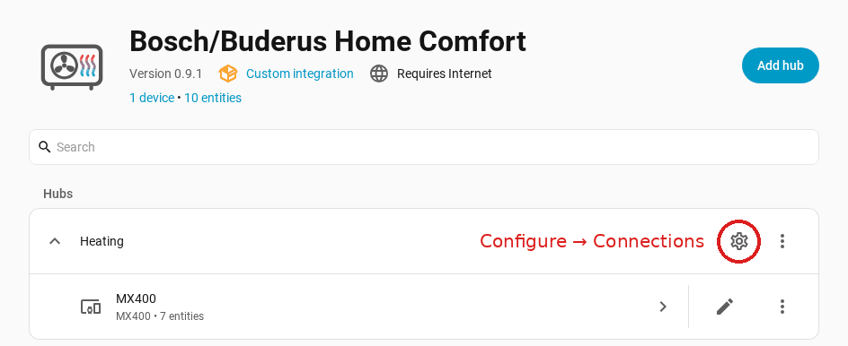

  

<h1 align="center">Bosch/Buderus Home Comfort</h1>

  Connect compatible Bosch and Buderus heating, cooling, hot-water, air-treatment and water-softening devices to Home Assistant, with read-only wallbox monitoring.

  
  
  
  

Bosch/Buderus Home Comfort (formerly Bosch/Buderus Heating) is an unofficial
Home Assistant integration. Entities follow what each system reports, so only
supported readings and controls appear.

The cloud access (sign-in of the Bosch or Buderus app, PointT) works for all
supported systems. With a K40/K40RF gateway (for example an MX400 internet
module, firmware 15.00.01 or newer) you can add a local access in your home
network or use it alone. Together, the local access supplies the readings it
offers (more values, updated more often) and the cloud handles every change,
because the integration uses the local interface for reading only. If the
cloud is unavailable, readings and current faults continue from the local
access; when it is back, the same entities carry on with their history.

> [!IMPORTANT]
> **0.9.1 is the current version** and needs Home Assistant 2026.5.0 or newer.
> Updating from 0.8.x? Make a full backup first, see [Updating](#updating).

## Features

- Readings of heating circuits, hot water, heat sources, system pressure, starts and operating hours
- Cumulative energy counters, including a calculated environmental energy
- Controls for operating modes, setpoints, hot water, extra hot water, Silent Mode and away mode, where the system offers them
- **Operate appliance** dialog with heating-circuit climates and a native hot-water entity
- Heating and hot water schedules and holiday periods with calendar
- Faults, warnings and maintenance messages with bell notifications and events for automations
- Room controllers of the RRC 2.0 platform: zones, programs, absences, radio devices
- Optional read-only **local access** that updates many readings more often and keeps them available without the cloud
- Additional device families: water heaters, air conditioners, air purifiers, dehumidifiers, the WE800i water softener and read-only wallboxes
- Redacted diagnostics and texts in 19 languages

What changed in each version is in the [changelog](CHANGELOG.md) and the
[release notes](https://github.com/SoftwareSchmied/ha-bosch-buderus-heating/releases).

## Supported systems

| System | Cloud | Local | Both |
|---|:---:|:---:|:---:|
| K40/K40RF gateways (for example MX400 internet module, K40 RF Connect-Key) on heat pumps and boilers | ✓ | read only | ✓ |
| K30/K30RF gateways (for example MX300 internet module, K30 RF Connect-Key) | ✓ | – | – |
| iCom gateways (for example KM200, KM100, KM50, MB LAN 2) | ✓ | – | – |
| RRC 2.0 room controllers (TC100.2; CT200 expected) | ✓ | – | – |
| Other device families: water heaters, air conditioners, air purifiers, dehumidifiers, WE800i water softener, wallboxes (read only) | expected | – | – |

Examples of heating systems (details in [confirmed installations](docs/confirmed-installations.md)):

- **K40/K40RF:** air-to-water heat pumps Logatherm WLW176i and WLW186i, confirmed.
- **K30/K30RF:** split heat pump Logatherm WLW196i AR and gas boiler Logamax plus GBH192i.2, confirmed (readings, partly holidays read-only).
- **iCom:** gas boiler Logamax plus GB172 with KM200, confirmed (readings only).
- **RRC 2.0:** gas boiler Logano plus GB212 with TC100.2, confirmed; CT200 expected, untested.
- Other brands (IVT, Junkers, Nefit, Worcester, Vulcano) should work, not confirmed.

- **Local** needs K40/K40RF firmware 15.00.01 or newer and only reads; with
  **both**, the local access reads and the cloud handles every change. Local
  access is confirmed on heat pumps, expected on boilers.
- iCom gateways, room controllers and the other device families are cloud
  only. The other device families still need checks on real devices.
- **Brands:** sign-in with the Bosch or Buderus app; the confirmed
  installations are Buderus systems. IVT, Junkers, Nefit, Worcester and
  Vulcano use the same cloud and are expected to work, not confirmed yet.
- **Not covered:** Matter devices, arbitrary MQTT devices and gateway network
  administration.

Details: [supported systems](docs/compatibility.md#supported-systems-at-a-glance),
[confirmed installations](docs/confirmed-installations.md),
[device families](docs/device-support-plan.md),
[room controllers](docs/room-controllers.md) and what is actually tested in the
[project status](docs/specification-status.md).

## Installation

Requirements: Home Assistant 2026.5.0 or newer, [HACS](https://www.hacs.xyz/docs/use/download/download/)
and a SingleKey ID account already connected to the Bosch or Buderus app (not
needed for local access only).

1. Open **HACS**, search for **Bosch/Buderus Home Comfort** and select **Download**.
2. Restart Home Assistant.

Not found? See the [search troubleshooting](docs/setup.md#repository-does-not-appear-in-hacs-search).

## Add the integration

Open **Settings → Devices & services → Add integration**, search for
**Bosch/Buderus** and choose the connection:

- **Cloud access:** readings and all controls. Select the brand of your app and
  sign in with its SingleKey ID; Home Assistant never asks for the password.
- **Cloud and local access** (recommended when possible): the same, plus the
  local gateway. Changes always go through the cloud.
- **Local access only:** readings only, no controls.

The illustrated [setup guide](docs/setup.md) shows every step, including the
[SingleKey ID sign-in](docs/setup.md#sign-in-with-singlekey-id) and the
[local access](docs/setup.md#set-up-the-local-access). Never share the return
address of the sign-in; it contains a one-time code.

To add, test, sign in again or remove a cloud or local access later, open the gear
icon (**Configure**) of the entry and choose **Connections**.

## Entities and dashboards

Entity names start with the part of the system, for example
`Heating circuit 1 – Operation mode` or `Hot water – Actual temperature`.
Everyday readings and controls are enabled; technical and identifying values
stay disabled. The [entity catalog](docs/entities.md) lists every entity with
its source, default state and polling interval.

For a hydraulic view of the heat pump on a dashboard, the
[Heat Pump Hydraulic Card](https://github.com/Sturmi77/heatpump-hydraulic-card)
has a preset for this integration (`preset: bosch_buderus_heating`). See
[using the hydraulic card](docs/entities.md#using-the-heat-pump-hydraulic-card).

## Controls and safety

- Before a change, the integration checks again that the setting is writable and the value lies within the limits the system currently reports.
- It sends one write request and never retries it blindly.
- A separate read-back must confirm the result; otherwise Home Assistant reports the change as failed.
- The integration changes nothing on its own; writes start only from you or your automations.

See [heating controls](docs/heating-controls.md) and
[PointT hot water](docs/pointt-hot-water.md).

## Updating

HACS shows new versions; read the release notes, select **Update** and restart
Home Assistant. From 0.8.x the configuration entry moves to storage format 4,
which 0.8.x cannot load: make a full Home Assistant backup before you update,
because going back is only possible by restoring it. 0.9 needs Home Assistant
2026.5.0 or newer. See [updating](docs/setup.md#updating).

## Feedback, support and diagnostics

**Feedback on 0.9.x:** please share how the integration works on your system in the [0.9.x feedback discussion](https://github.com/SoftwareSchmied/ha-bosch-buderus-heating/discussions/111). Let Home Assistant run for at least a few hours first (ideally half a day, so that slower readings, counters and the firmware check have values), then attach the diagnostics: **Settings → Devices & services → Bosch/Buderus Home Comfort → ⋮ → Download diagnostics**. The file is redacted (no serial numbers, tokens, e-mail or addresses), but please have a quick look before posting. It lets me check that everything on your system is read and shown correctly, and it adds your heat generator model to the model table.

- **Questions and ideas:** [GitHub Discussions](https://github.com/SoftwareSchmied/ha-bosch-buderus-heating/discussions)
  (**Questions and help**, **Ideas and requests**, **Installations and examples**), please in English.
- **Your system:** add it to [Share your installation](https://github.com/SoftwareSchmied/ha-bosch-buderus-heating/discussions/81).
- **Bugs:** open an [issue](https://github.com/SoftwareSchmied/ha-bosch-buderus-heating/issues/new/choose).
  Check the [troubleshooting](docs/setup.md#troubleshooting) first, download the
  diagnostics before reloading, and note the time and exact message.

Never publish tokens, sign-in return addresses, gateway IDs, serial numbers or
unredacted API responses. The [diagnostics guide](docs/diagnostics.md) explains
what the report contains.

## Documentation

- **Getting started:** [setup guide](docs/setup.md), [reconfiguration](docs/reconfiguration.md), [cloud and local access](docs/operation-without-cloud.md), [source selection](docs/source-selection.md)
- **Operating:** [heating controls](docs/heating-controls.md), [PointT hot water](docs/pointt-hot-water.md), [holiday periods](docs/holiday-periods.md), [older holiday formats](docs/legacy-holidays.md), [season switching](docs/season-switching.md)
- **Room controllers:** [overview](docs/room-controllers.md), [zones and schedules](docs/rrc-zones-and-schedules.md), [zone controls](docs/zone-controls.md), [zone and DHW additions](docs/zone-and-dhw-fields.md)
- **Readings:** [entities and polling](docs/entities.md), [faults and notifications](docs/faults.md), [validity of readings](docs/reading-validity.md), [device presentation](docs/device-presentation.md), [names and languages](docs/resource-names-and-languages.md), [translations](docs/translations.md)
- **Other devices:** [device families](docs/device-support-plan.md), [water heaters](docs/bacon-water-heaters.md), [air conditioners](docs/bacon-air-conditioners.md), [air purifiers](docs/bacon-air-purifiers.md), [dehumidifiers](docs/bacon-dehumidifiers.md), [connection](docs/bacon-connection.md), [wallboxes](docs/pointt-wallboxes.md), [water softener](docs/water-softener.md), [WE800i validation](docs/water-softener-validation.md), [WDDW2 types](docs/wddw2-types.md)
- **Reliability:** [request behavior](docs/request-behavior.md), [connection recovery](docs/connection-recovery.md), [diagnostics](docs/diagnostics.md)
- **Status:** [compatibility](docs/compatibility.md), [confirmed installations](docs/confirmed-installations.md), [project status](docs/specification-status.md), [roadmap](docs/roadmap.md)
- **Maintainers:** [architecture](docs/architecture.md), [resource catalog](docs/resource-catalog.md), [resource inventory](docs/resource-inventory.md), [anonymized inventory](docs/anonymized-inventory.md), [privacy and test data](docs/privacy-and-fixtures.md), [release checks](docs/release.md)

## Development

Development setup, checks and contribution rules are in
[CONTRIBUTING.md](CONTRIBUTING.md). Contributions for additional Bosch/Buderus
installations are welcome when they follow the repository's privacy and
fixture rules.

## License and trademarks

The project is licensed under the [MIT License](LICENSE).

This is an independent community project. It is not affiliated with, endorsed
by, or supported by Bosch, Buderus, Bosch Home Comfort, or Home Assistant.
Names and trademarks are used only to describe compatibility.
