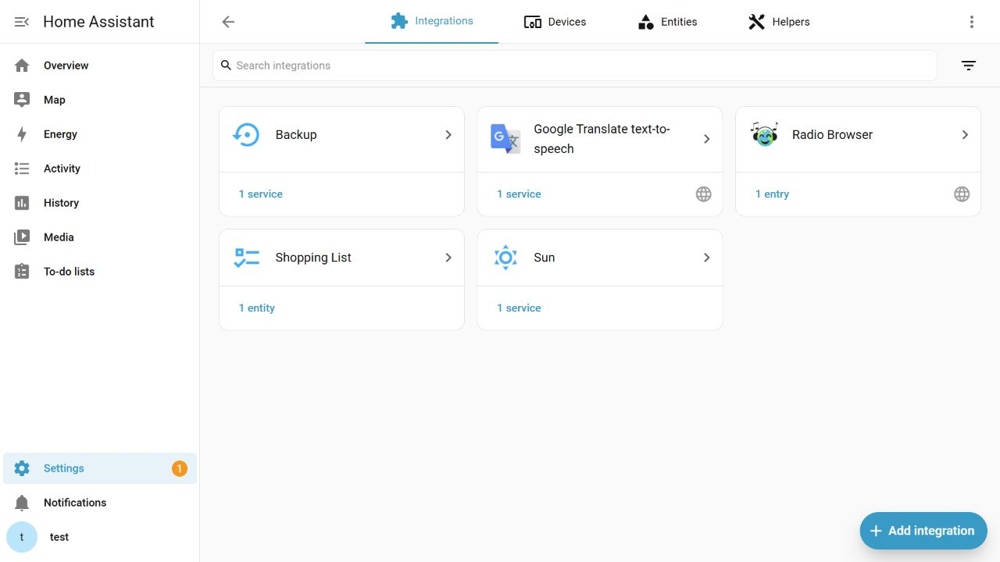
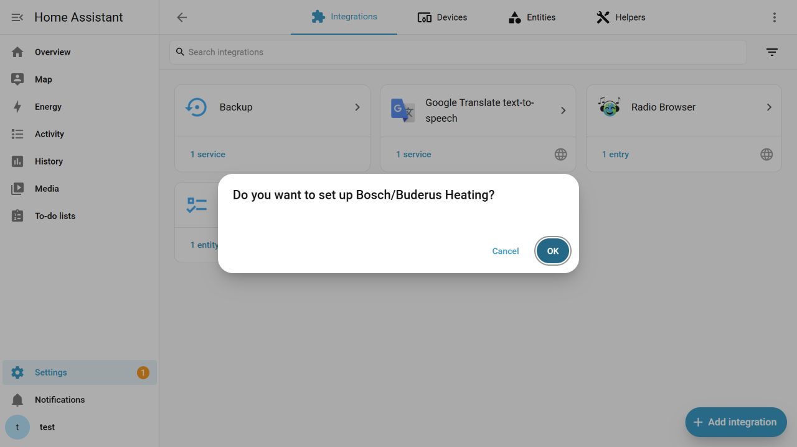
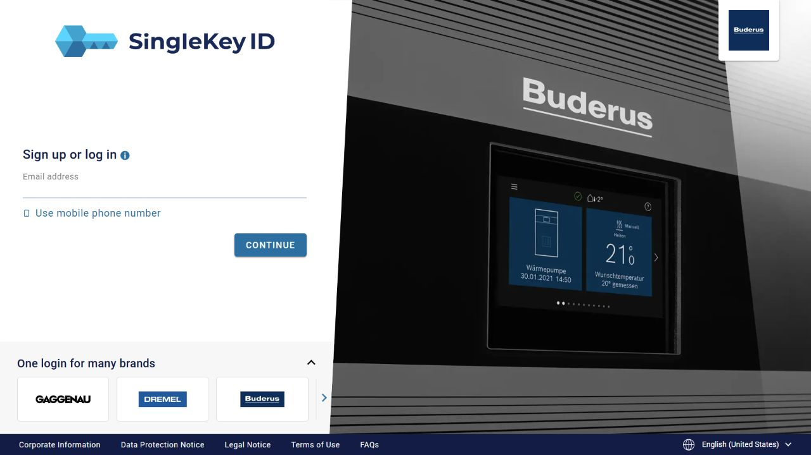
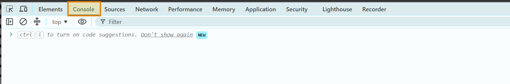
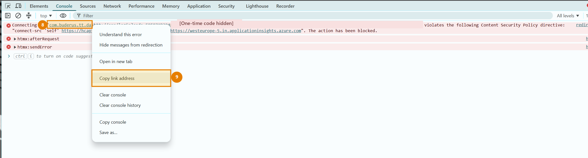

# Setup guide

This guide walks through installation and sign-in step by step. No previous
knowledge of OAuth, APIs, or the PointT Cloud API is required.

**Bosch/Buderus Home Comfort**, formerly **Bosch/Buderus Heating**, connects
compatible Bosch and Buderus heating systems and supported additional cloud
appliances to Home Assistant. Detected devices and entities are created
automatically according to their reported capabilities.

The new display name ships with **0.8.2-beta.7**. Older 0.8.1 and
0.8.2-beta.6 installations still show **Bosch/Buderus Heating**. Both
names refer to the same repository and integration; update the existing entry.
Its saved title and custom device/entity names are retained. The instructions
below use the new project name; use the former name where the installed version
still displays it.

## Requirements

- a compatible Bosch or Buderus heating system with an MX300, MX400, K30/K30RF,
  K40/K40RF, or another compatible PointT gateway;
- a working SingleKey ID account that is already connected to the heating app;
- a Home Assistant user account with administrator permissions;
- a computer with a current web browser;
- about ten minutes.

Enter the SingleKey ID password only on the official SingleKey ID website.
Neither Home Assistant nor this integration asks for that password.

## Installation with HACS

### HACS is not installed yet

1. Open the official
   [HACS installation guide](https://www.hacs.xyz/docs/use/download/download/).
2. Select the Home Assistant installation type and follow the instructions.
3. Restart Home Assistant.
4. Open **Settings → Devices & services → Add integration** and search for
   **HACS**.
5. Select **HACS** and complete the GitHub sign-in shown by Home Assistant.

HACS then appears in the Home Assistant sidebar.

### Install Bosch/Buderus Home Comfort

The integration is included in the default HACS catalog. Find it
using the search below; HACS will notify you about future updates.

1. Open **HACS** in Home Assistant.
2. Enter **Bosch/Buderus** in the **Search** field at the top.
3. Open **Bosch/Buderus Home Comfort**, or **Bosch/Buderus Heating** while the
   former name is still shown. Check that the repository is
   `SoftwareSchmied/ha-bosch-buderus-heating`.
4. Select **Download**.
5. Confirm the suggested current version.
6. Restart Home Assistant completely when HACS asks you to do so.

> [!NOTE]
> The HACS download installs the required files. **Bosch/Buderus Home Comfort**
> becomes available under **Settings → Devices & services** only after Home
> Assistant has restarted.

#### Repository does not appear in HACS search

The integration is listed in the default catalog. If it is missing from your
search results:

1. Search in **HACS**, rather than Home Assistant's **Add integration** dialog.
2. Clear any filters that limit the results, such as showing only downloaded
   repositories, and search for **Bosch/Buderus** or **Buderus**.
3. Check that HACS is up to date and can connect to GitHub. If HACS reports a
   connection or rate-limit error, resolve it or wait for the indicated retry
   time, then search again after the catalog has refreshed.
4. If it is still missing, include your HACS version and any displayed error
   when [requesting help](#request-help).

The standard installation does not require a custom repository entry. If you
previously installed this same repository manually through HACS, continue to
update that installation through HACS; reinstalling the integration is not
required.

## Add the integration

1. Open **Settings** in Home Assistant.
2. Go to **Devices & services** and open **Integrations**.
3. Select **Add integration** in the lower-right corner.

*The button is in the lower-right corner.*

4. Search for **Bosch/Buderus**, then select the name shown by the installed version.
5. Confirm the Home Assistant prompt with **OK**.

6. Select the brand of the smartphone app that is already connected to the
   heating system:

   - **Bosch** when using the Bosch app;
   - **Buderus** when using the Buderus app.

The app determines this selection. The logo on the heat pump or indoor unit
alone is not sufficient.

## Sign in with SingleKey ID

Home Assistant now shows a **SingleKey ID** link and an empty input field below
it.

**SingleKey ID is the same account used by the Bosch or Buderus app.** Sign in
with the same email address or mobile number and password as in the heating
app. No new account or additional Home Assistant password is required. The
setup dialog creates a new link for every sign-in attempt, so always open the
link directly from that dialog.

*The page may look slightly different depending on the selected brand, screen
size, and language. Enter the email address or mobile number of the existing
SingleKey ID account.*

Use Google Chrome on a computer for the steps below. Open Developer Tools
before signing in and keep its messages across page changes:

1. Keep the Home Assistant setup dialog open.
2. Open its **SingleKey ID** link in a new Chrome tab.
3. Press `F12` in the SingleKey ID tab.
4. Select **Console** at the top of Developer Tools.

   Open **Console settings** using the small gear on the Console toolbar and
   enable **Preserve log** (German: **Protokoll beibehalten**). This keeps
   messages when the sign-in page redirects. Clear the **Filter** field and
   select **All levels** so errors are not hidden.

   

   *The highlighted **Console** tab may have a localized name in Chrome.*

5. Sign in with the same SingleKey ID account used by the heating app.
6. Complete all required sign-in steps.
7. After sign-in, the page may report **Are you having network problems? The
   request could not be completed.** This normally does not indicate a broken
   internet connection. Chrome was simply unable to open the smartphone app's
   redirect address.
8. Find the red message near the bottom of the Console that contains a blue
   app address. Depending on the Chrome version, it starts with **Failed to
   launch** or **Connecting to**.
9. The message contains a long blue address. Depending on the selected brand,
   it starts with one of these values:

   - Bosch: `com.bosch.tt.dashtt.pointt://app/login?code=...`
   - Buderus: `com.buderus.tt.dashtt://app/login?code=...`

   

   *Markers **8** and **9** identify the app address and the correct context
   menu item. The one-time code is hidden in the screenshot.*

10. Right-click the blue address.
11. Select **Copy link address**. Do not open or send the link.
12. Return to the Home Assistant tab, leaving the setup dialog open.
13. Paste the complete copied address with `Ctrl+V` into **Complete redirect
    address**.
14. For security, the input may display dots instead of the address. This is
    expected.
15. Make sure the complete address was copied, not only the value after
    `code=`.
16. Select **OK**.

If the Console contains no matching message, follow
[Chrome Console is empty or the redirect address is missing](#chrome-console-is-empty-or-the-redirect-address-is-missing).
Always use the redirect address from the same attempt as the currently open
Home Assistant setup dialog. An address from an older attempt is rejected for
security reasons.

> [!IMPORTANT]
> The redirect address contains a short-lived one-time code. Never publish it
> in a GitHub issue, chat, screenshot, or log.

## Select gateways

After successful sign-in, Home Assistant requests the gateways associated with
the account.

1. Select every gateway that Home Assistant should use.
2. If there is only one entry, select that entry.
3. For similarly named gateways, use the displayed last four characters to
   distinguish them.
4. Select **Submit**.

**Bosch/Buderus Home Comfort** now appears as a configured integration. Open
**Devices** on its integration card to find the detected heating equipment and
entities. Devices can then be assigned to areas and dashboards.

## Everyday operation from Beta.7

The following controls are included in **0.8.2-beta.7**. The older
0.8.2-beta.6 and stable 0.8.1 packages do not contain this dialog. Select Beta.7
explicitly in HACS, restart Home Assistant and reload the browser after updating.

1. Open **Settings > Devices & services > Bosch/Buderus Home Comfort > Configure**.
2. Select **Operate appliance**. With several PointT gateways, select the
   appliance first.
3. Choose the heating-circuit, hot-water or system tab. Additional settings stay
   visible under **More settings**.
4. Edit the desired fields and select **Apply**. Wait for confirmation before
   treating an edit as applied. **Discard** or **Escape** discards unsaved edits.

The German route is **Einstellungen > Geräte & Dienste > Bosch/Buderus Home Comfort >
Konfigurieren > Anlage bedienen**. The dialog follows the profile language.
This is separate from **Reconfigure**, which changes gateway selection and
polling and starts resource discovery again.

On the device page, tap the heating-circuit climate or hot-water entity to open
Home Assistant's native controls. Those controls write immediately. The original
controls for the heating mode, manual target and hot-water mode remain under
**Configuration**, with their IDs and custom names retained.
See the [heating guide](heating-controls.md) and
[PointT hot-water guide](pointt-hot-water.md) for supported operations and limits.

## Updating

For a HACS installation, Home Assistant displays an available new version.
Open the notification, read the release notes, and select **Update**. Restart
Home Assistant if HACS requests it. Reload the browser after an update that
changes the dialogs. Reinstalling the integration or deleting existing entities
is not necessary.

## Troubleshooting

### The new controls are missing or look different

- Check the installed integration version and its release notes. The new
  PointT dialog, climate and hot-water entity described above are currently
  development features, even if a local test build retains the Beta.6 version
  label. The published Beta.6 package does not contain them.
- After installing a build that includes them, restart Home Assistant and
  reload the browser. Check disabled entities as well.
- Entities follow the resources offered by each circuit. A missing valid
  capability can prevent a combined entity from appearing; existing individual
  controls can still be available. The [heating guide](heating-controls.md)
  explains availability and automatic-mode limitations.
- A profile-language change translates dialogs but does not rename entities.
  Names follow the system language or a custom name; see the
  [language guide](resource-names-and-languages.md).

### Chrome Console is empty or the redirect address is missing

An empty Console does not show whether sign-in completed or the browser tried
to open the app address. It is not enough to identify an expired token.

1. Start a fresh sign-in attempt in Home Assistant. Keep that dialog open and
   open its **SingleKey ID** link in a new Chrome tab. Use this link rather
   than a bookmark or the general SingleKey ID website.
2. In the **SingleKey ID tab**, press `F12` and select **Console** before
   signing in. Open the small **Console settings** gear and enable
   **Preserve log**. Clear **Filter** and select **All levels**. Keep Developer
   Tools open while completing every sign-in step.
3. Look for **Failed to launch** or **Connecting to** and the
   `com.bosch...://` or `com.buderus...://` address. If it appears, use
   **Copy link address** and paste the full address into the still-open
   Home Assistant dialog.
4. If no address appears, note the page displayed after sign-in. If it is the
   SingleKey ID account home page, follow
   [SingleKey ID home page appears after sign-in](#singlekey-id-home-page-appears-after-sign-in).
   Otherwise, [request help](#request-help) with your Chrome version, operating
   system, Home Assistant version and integration version, plus any visible
   page error. Mention whether Developer Tools was open before signing in.

Each Home Assistant sign-in attempt is valid for ten minutes. After that,
start a new attempt and use its new link. Do not delete an existing integration
entry to do this. If a rate-limit message asks you to wait, wait for that
interval before trying again.

When describing the page, share only its domain and path, omitting everything
from `?` or `#` onward. Do not share the app redirect address, sign-in codes,
tokens or account details. Check any screenshot for these details first.

**Preserve log** prevents messages from being cleared during page changes; it
does not guarantee that Chrome will produce the expected redirect message.
See the [Chrome documentation](https://developer.chrome.com/docs/devtools/console/reference#persist)
for the setting.

#### Deutsch: Keine Rückleitungsadresse in der Konsole

Eine leere Konsole allein zeigt nicht, ob die Anmeldung abgeschlossen wurde
oder der Browser versucht hat, die App-Adresse zu öffnen.

1. Starte in Home Assistant einen neuen Anmeldeversuch und öffne dessen
   **SingleKey ID**-Link in einem neuen Chrome-Tab. Lasse den Dialog in
   Home Assistant geöffnet. Verwende kein Lesezeichen und nicht die allgemeine
   SingleKey-ID-Webseite.
2. Öffne im **SingleKey-ID-Tab vor der Anmeldung** mit `F12` die **Konsole**.
   Aktiviere über das kleine Zahnrad der Konsolenleiste
   **Protokoll beibehalten / Preserve log**. Leere das Filterfeld und wähle
   **Alle Ebenen / All levels**. Lasse die Entwicklerwerkzeuge während der
   gesamten Anmeldung geöffnet.
3. Suche nach **Failed to launch** oder **Connecting to** und der
   `com.bosch...://`- beziehungsweise `com.buderus...://`-Adresse. Kopiere sie
   über **Link-Adresse kopieren** vollständig in den offenen HA-Dialog.
4. Bleibt die Adresse aus, nenne bei einer Rückfrage die Chrome-Version,
   das Betriebssystem, die HA- und Integrationsversion sowie die nach der
   Anmeldung angezeigte Seite oder Fehlermeldung. Schreibe dazu, ob die
   Entwicklerwerkzeuge schon vor der Anmeldung geöffnet waren.

Ein Anmeldeversuch gilt zehn Minuten. Beginne danach mit einem neuen Link;
ein bestehender Integrationseintrag muss dafür nicht gelöscht werden. Halte
eine angezeigte Wartezeit ein. Teile von einer Webseitenadresse nur Domain
und Pfad ohne den Teil ab `?` oder `#`. Veröffentliche keine App-Rückleitungsadresse,
Anmeldecodes, Tokens oder Kontodaten, auch nicht in Screenshots.
**Protokoll beibehalten** erhält vorhandene Meldungen bei Seitenwechseln,
garantiert aber nicht, dass die erwartete Meldung entsteht.

### SingleKey ID home page appears after sign-in

An address such as `https://singlekey-id.com/en-us/home` is not the required
sign-in result and must not be pasted into Home Assistant.

1. Return to the Home Assistant tab.
2. Open the **SingleKey ID** link shown in the setup dialog again. Do not open
   SingleKey ID from a bookmark or by manually entering its website address.
3. If the home page appears again, close the setup dialog.
4. Add **Bosch/Buderus Home Comfort** again and repeat sign-in with the newly
   generated link.

### Browser opens the heating app

Return to the browser and repeat sign-in on a computer. If the browser asks
before opening the app, select **Cancel**. Before the next attempt, press
`F12` and open the Console. Then copy the complete
`com.bosch...://` or `com.buderus...://` address from the **Failed to
launch** or **Connecting to** message as described above.

### Home Assistant reports an invalid redirect address

- Confirm that the complete address was pasted.
- Do not use an address from an older sign-in attempt.
- If Home Assistant shows a new sign-in link, open that link and repeat sign-in.
- Confirm that the selected Bosch or Buderus brand matches the app.

Each sign-in attempt is valid for ten minutes. If it expires, Home Assistant
shows an explanation and a fresh SingleKey ID link. Open that new link and
repeat sign-in; an address from the previous attempt will not work. During
reauthentication, the existing integration entry and gateway selection are kept.
There is no need to delete the integration.

### SingleKey ID asks you to wait

If SingleKey ID limits sign-in requests, Home Assistant shows the remaining
wait in seconds. Wait for that interval and select **Submit** to obtain a new
sign-in link. Submitting early does not send another token request or extend
the wait. Without a usable wait time from the server, the pause is five minutes.

### PointT service cannot be reached

Check the Home Assistant internet connection and wait briefly. If Home
Assistant displays **Retry gateway discovery**, select **Submit** again; no new
sign-in is required.

### No gateway is found

- Open the official heating app and confirm that the system is online.
- Confirm that the correct SingleKey ID account was used.
- Confirm the selected brand.
- Compare the gateway with the compatibility list in the README. If it is
  listed, create a bug report as described below.

### Integration is not shown in search

First determine where the search fails:

- **Not found in HACS:** check the search term, active filters and HACS catalog
  access as described under
  [Repository does not appear in HACS search](#repository-does-not-appear-in-hacs-search).
- **Downloaded in HACS but missing from Add integration:** restart Home
  Assistant completely. Then check **Settings → System → Logs** for a loading
  error involving `bosch_buderus_heating`.

## Request help

Always remove the following data before sharing diagnostics:

- redirect addresses and OAuth codes;
- access and refresh tokens;
- gateway IDs, serial numbers, and network identifiers;
- email addresses and other account data.

The rules for safe diagnostics are documented in
[Privacy and test data](privacy-and-fixtures.md).

Bug reports and feature requests can be submitted through the
[GitHub issue tracker](https://github.com/SoftwareSchmied/ha-bosch-buderus-heating/issues).
Include the Home Assistant version, integration version, gateway model, and
exact error message without attaching any of the secret or personal data
listed above.
